
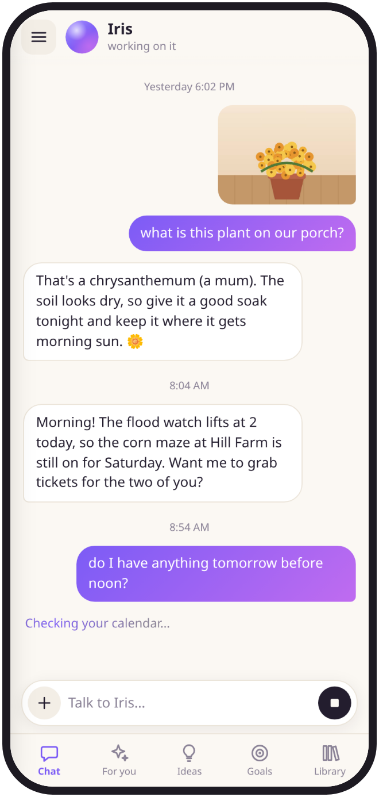
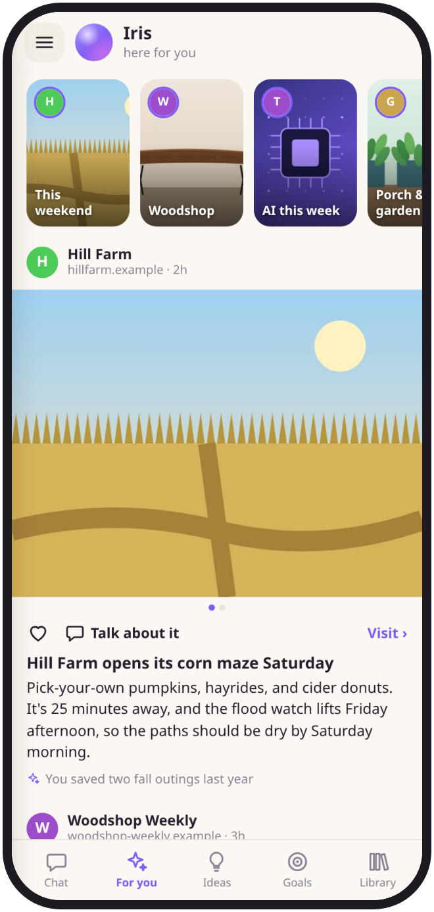
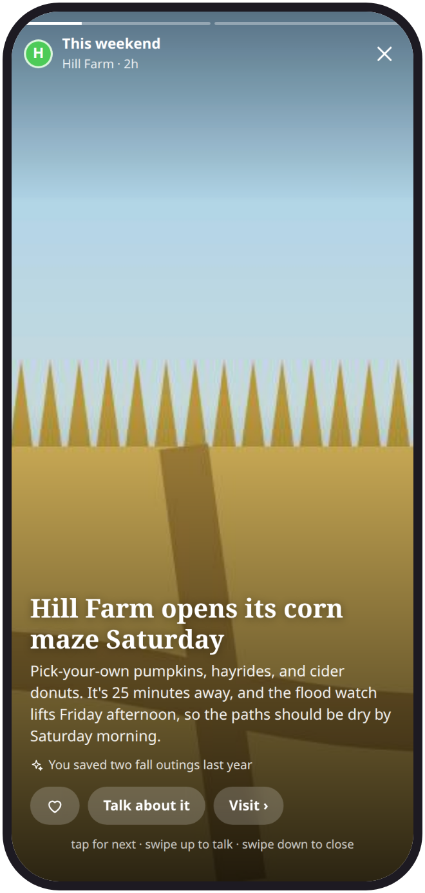
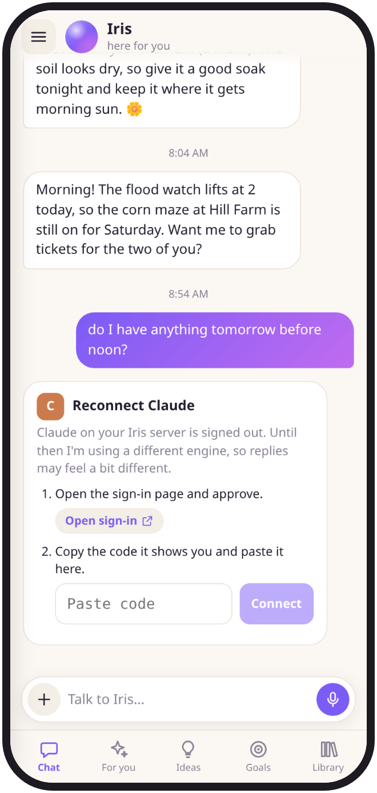
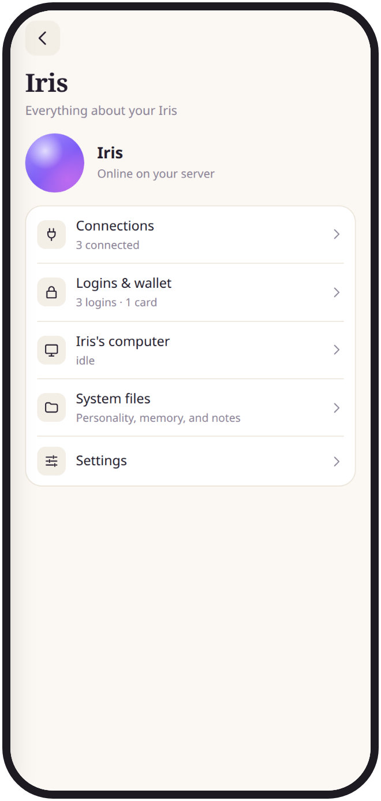
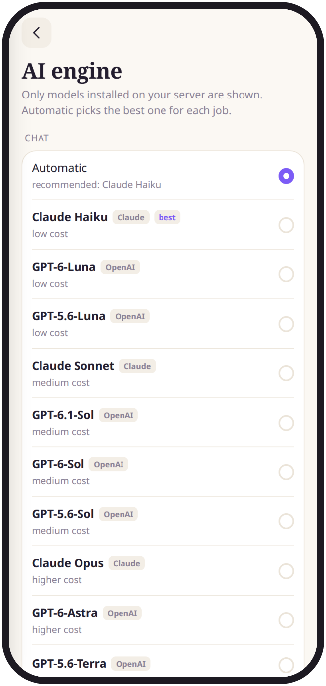
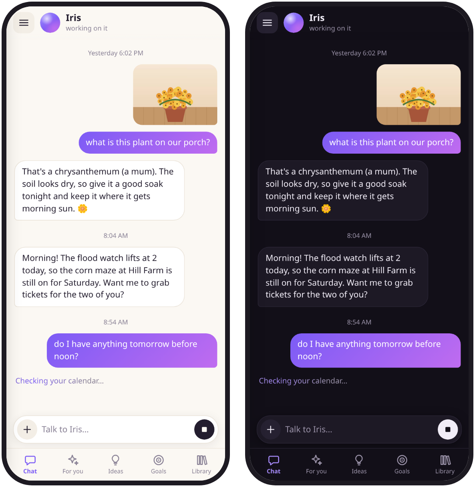

<h1 align="center">Iris</h1>

<p align="center">
  <b>Your own personal AI agent, on your own machine.</b><br>
  An assistant as easy to use as the big consumer apps. It runs on hardware you
  control, works with whichever AI models you already have, and keeps your
  data and memory as plain files you own.
</p>

<p align="center">
  
</p>

---

## Why Iris

Consumer AI assistants are great to use. But your chats, memories and habits
live on someone else's servers, and you can't see or change what the
assistant knows about you.

Iris gives you that experience without the trade:

- **You own everything.** Iris runs on your computer. Its personality, memory
  and everything it knows about you are plain markdown files you can read and
  edit, from the app or on disk. There's no telemetry: we never see your
  chats.
- **No lock-in.** Iris works with the AI tools you already have: **Claude
  Code**, **Codex**, **Gemini CLI**, or **OpenCode** with open-source models
  running entirely on your own hardware. Use one, or mix them.
- **Dead simple.** No model names, token counts or set up overwhelm. You talk to
  Iris and she gets things done. Everything technical is there if you go
  looking, and invisible if you don't.
- **Never touch your server again.** Once your phone is paired, you handle
  sign-ins, connections, new AI engines, updates and new models from the
  app.

## What it's like

<table>
  <tr>
    <td width="50%" valign="top">
      <h3>Talk to Iris</h3>
      <p>Send a message, a photo, or use your voice. While Iris works, she
      tells you what she's doing in plain words: "Checking your calendar…",
      "Searching the web…". When she's done, tap the summary to see every
      step she took. If a task fails, you get a notification saying so,
      instead of waiting forever.</p>
    </td>
    <td width="50%"></td>
  </tr>
  <tr>
    <td width="50%"></td>
    <td width="50%" valign="top">
      <h3>A feed that's actually for you</h3>
      <p>Iris looks around while you're busy and builds a small, curated feed
      from the things you care about: story cards by topic, real posts with
      their original photos, a short summary, why she thought of you, and a
      link to the source. She learns from what you like. Tap
      <b>Talk about it</b> to chat about any post.</p>
    </td>
  </tr>
  <tr>
    <td width="50%" valign="top">
      <h3>Stories, swipe by swipe</h3>
      <p>Tap a topic for full-screen stories. Tap for the next story, swipe
      sideways to change topic, swipe up to reply to Iris, and swipe down
      when you're done.</p>
    </td>
    <td width="50%"></td>
  </tr>
  <tr>
    <td width="50%"></td>
    <td width="50%" valign="top">
      <h3>Fix things from the chat</h3>
      <p>When a sign-in expires, Iris posts a <b>Reconnect</b> card and sends
      a notification. Tap it, approve with your provider, and you're back. It
      uses the provider's own official sign-in, and Iris never sees your
      password or token. Meanwhile, she quietly switches to another model
      you have.</p>
    </td>
  </tr>
  <tr>
    <td width="50%" valign="top">
      <h3>Everything, when you want it</h3>
      <p>Ideas Iris has for you, goals she's tracking, a library of
      everything she's made, your connections, an encrypted store for logins
      Iris can use but never see, and the system files that make Iris who
      she is. It's all one tap away, and out of the way until you need it.</p>
    </td>
    <td width="50%"></td>
  </tr>
  <tr>
    <td width="50%"></td>
    <td width="50%" valign="top">
      <h3>Smart defaults, your choice</h3>
      <p>Iris picks the best model you have for each job from a built-in
      ranking, starts every request at low effort, and thinks harder only
      when the conversation needs it. Install a better model and the default
      upgrades itself. Prefer a specific model? Pin it.</p>
    </td>
  </tr>
</table>

<p align="center">
  <br>
  <sub>Follows your phone's light and dark mode.</sub>
</p>

## How it works

Iris is a single small Rust program (about 9 MB, idling at around 10 MB of
memory) that runs on any Linux machine: an old desktop, a mini PC or a home
server. You open it on your phone as an app (installable from the browser,
no app store).

Iris doesn't run its own AI. Like [T3 Code](https://github.com/pingdotgg/t3code),
it **wraps the official AI command-line tools** you've signed in to: Claude
Code, Codex, Gemini CLI or OpenCode. They do the thinking and the work. Iris
gives them a personality and memory, picks the right model, and turns
everything into a friendly app. It can install and update those tools for
you, from their official sources only.

```
Your phone ──(your private network)──▶ Iris on your computer ──▶ claude / codex / gemini / opencode
```

**Security by design**

- Listens only on your private network, such as [Tailscale](https://tailscale.com),
  never the open internet. Each device pairs with a one-time code.
- Secrets live in an encrypted vault the AI never reads.
- Connected services run through Iris, not the AI. Sending email or
  messages, buying things, deleting and contacting new people wait for your
  tap on an approval card. The card is built by Iris itself from the exact
  request, so the AI can't disguise what it's sending.
- Uses only the official, unmodified AI tools signed in through their own
  official flows. Iris never handles your subscription credentials.

## Get started

You need a Linux machine and one AI tool you're signed in to (or none: Iris
can install one for you).

```sh
cargo build --release
install -Dm755 target/release/iris ~/.local/bin/iris

iris init     # sets up Iris's home folder
iris serve    # starts Iris
iris pair     # prints a one-time code for your phone
```

To reach Iris from your phone, share it on your private network over HTTPS
(with Tailscale that's one command, `tailscale serve --bg 7420`; see
[using Iris from your phone](docs/SELF-HOSTING.md#using-iris-from-your-phone)).
Then open Iris on your phone, enter the code, and tap **Add to Home Screen**.
That's the last time you need the terminal.

Moving from OpenClaw? `iris import openclaw <workspace>` brings your agent's
personality and memory along.

The **[self-hosting guide](docs/SELF-HOSTING.md)** covers private-network
setup, running Iris as a service, the optional two-user security split, and
every setting.

## Status

Iris is **early** and moving fast. What works today:

- ✅ Chat with photos, live status, step-by-step receipts, and "I got stuck"
  notifications
- ✅ Claude Code, Codex, Gemini CLI and OpenCode (including local models),
  with ranked automatic defaults and effort that adapts to the conversation
- ✅ Reconnect cards for Claude and Codex sign-ins; API keys for Gemini CLI
  and OpenCode from the app; installing and auto-updating engines from the
  app
- ✅ Connections (Google Workspace, GitHub, one-tap Notion, Todoist, Linear,
  Sentry, Supabase, Stripe and more, any MCP server) through Iris's gateway:
  Allow / Ask / Off per action on each service's page,
  approval cards for sends, purchases, deletions and new recipients,
  trusted people, tripwires, Pause Iris and Disconnect everything
- ✅ For you feed with stories, Ideas, Goals, Library, system file editing
- ✅ Automatic feed sources (RSS, YouTube, Reddit, Hacker News, Bluesky,
  Mastodon) with rule-based ranking, adaptive size, and two small model
  calls a day
- ✅ Push notifications, quiet hours with a digest afterwards, an encrypted
  credentials vault
- ✅ Iris's own browser: watch it live, take over from your phone, and let
  Iris sign in with saved logins (cards always ask first)
- 🧪 Shared chats with more than one person (preview)

On the way:

- 🚧 Voice replies
- 🚧 A character for Iris

## Contributing

Iris is open source and contributions are welcome. Please read
**[CONTRIBUTING.md](CONTRIBUTING.md)** first. For bigger changes, open an
issue before you build. [AGENTS.md](AGENTS.md) lists the project's ground
rules, and [docs/DESIGN.md](docs/DESIGN.md) describes the app's design.

Found a security problem? Please report it privately through GitHub's
**Report a vulnerability** button, not in a public issue.

## License

Dual-licensed under [MIT](LICENSE-MIT) or [Apache 2.0](LICENSE-APACHE), at
your option.

Iris is an independent project. It is not affiliated with Anthropic, OpenAI,
Google or Meta. Claude, Codex, Gemini and other names are trademarks of their
respective owners. Use each provider's tools according to their terms.
